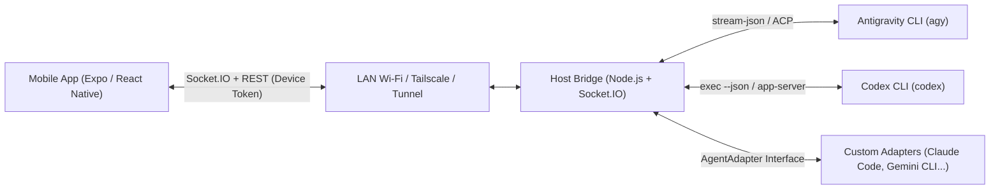

# Agent Remote

> **Native mobile remote control for coding agents** — work with **Antigravity CLI**, **OpenAI Codex CLI**, and ACP-compatible agents from your phone with zero web lag.

[](LICENSE)
[](https://www.typescriptlang.org/)
[](https://expo.dev/)
[](#architecture)

---

## Why Agent Remote?

Browser-based remote dashboards struggle on mobile: heavy DOM trees freeze during long token streams, diffs are hard to read, and reconnecting after locking your phone drops state.

**Agent Remote** splits the problem cleanly:

1. A lightweight **Host Bridge** runs on your dev machine (`Windows`, `macOS`, `Linux`) and talks to your local coding agents over structured JSON protocols (`stream-json`, `ACP`, `app-server`) — never fragile terminal screen-scraping.
2. A **Native Mobile App** (`React Native` + `Expo`) connects directly to your machine over **LAN Wi-Fi** or **Tailscale / Cloudflare Tunnel** with frame-batched streaming, collapsible tool cards, interactive approval sheets, and sequence-based event replay.

| Feature | Web Dashboard | SSH Terminal on Phone | **Agent Remote** |
| :--- | :---: | :---: | :---: |
| Smooth 60fps streaming on mobile | Laggy on long threads | Raw ANSI walls of text | **Frame-batched native FlatList** |
| Multi-agent (Antigravity + Codex + ...) | Single vendor | Manual CLI switching | **Unified Adapter Protocol** |
| Interactive tool approval UI | Clunky mobile web | Keyboard-heavy | **Native Bottom Sheet** |
| Reconnect after screen lock | Full reload | Session drop | **Seq-based delta replay** |
| Local-first privacy (no relay server) | Cloud-routed | Direct | **Direct LAN / Tailscale** |

---

## Architecture



### Monorepo Layout

```text
agent-remote/
├── packages/protocol/   # Shared TypeScript protocol (events, sessions, approvals, git diff)
├── apps/bridge/         # Local-first Host Bridge CLI & daemon (Express + Socket.IO + QR pairing)
└── apps/mobile/         # Native iOS / Android client (Expo Router + React Native)
```

---

## Supported Agents

| Agent | CLI Binary | Protocol | Status |
| :--- | :--- | :--- | :--- |
| **Google Antigravity** | `agy` | `stream-json` (ACP upgrade in progress) | **Ready** |
| **OpenAI Codex** | `codex` | `exec --json` (`app-server` upgrade in progress) | **Ready** |
| **Claude Code** | `claude` | `stream-json` | Planned (`good first issue`) |
| **Gemini CLI** | `gemini` | `ACP` | Planned (`good first issue`) |

Want to add your favorite coding agent? See [CONTRIBUTING.md](CONTRIBUTING.md) — implementing a new `AgentAdapter` takes ~60 lines of TypeScript.

---

## Quick Start

### 1. Clone & Install

```bash
git clone https://github.com/cngba3/agent-remote.git
cd agent-remote
npm install
npm run build
```

### 2. Start the Host Bridge on Your Dev Machine

```bash
npm run bridge:start -- --cwd /path/to/your/project
```

The terminal prints your local endpoint, a 6-character pairing code, detected agents (`agy`, `codex`), and a **QR code**.

> **Remote access outside Wi-Fi:** Start the bridge with `--public-url https://<your-tailscale-or-tunnel-url>` and scan the generated QR code.

### 3. Run the Mobile App

```bash
npm run mobile:start
```

Open with **Expo Go** (or a development build) on iOS / Android, tap **Scan Terminal QR Code**, and start steering your coding agents from your phone.

---

## Security & Privacy

- **Local-first by default**: Your prompts, source code, and diffs stay between your phone and your dev machine.
- **Explicit QR pairing**: Every mobile device exchanges a short pairing code for a random bearer token stored in hardware-backed storage (`expo-secure-store`).
- **Biometric verification**: Built-in support for Face ID / fingerprint via `expo-local-authentication`.

---

## Roadmap

- [x] Shared typed event protocol with monotonic sequence numbers (`seq`)
- [x] Host Bridge daemon with QR pairing, device tokens, and Socket.IO event replay
- [x] Antigravity CLI & Codex CLI adapters
- [x] Expo mobile app with QR scanner, Sessions Hub, frame-batched chat, Approval Sheet, and Git Diff viewer
- [ ] Full bidirectional ACP (`agy acp`) & `codex app-server` JSON-RPC transport
- [ ] Voice-to-prompt & screenshot attachment
- [ ] Push notifications when long-running agent turns finish or await approval
- [ ] Prebuilt Android APK & iOS TestFlight releases

---

## Contributing

Contributions, bug reports, and new agent adapters are welcome! Check [CONTRIBUTING.md](CONTRIBUTING.md) to get started.

## License

[MIT](LICENSE) © 2026 Dinh Quang Cuong
