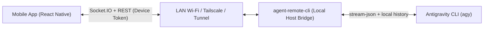

# Agent Remote

> **Native mobile remote control for Antigravity CLI (`agy`)** — steer your local coding agent, inspect git diffs, and attach screenshots from your phone with zero web lag.

[](https://www.npmjs.com/package/agent-remote-cli)
[](LICENSE)
[](https://expo.dev/)
[](#how-it-works)

---

## Why Agent Remote?

Browser-based remote dashboards lag on mobile during long streams and drop state when you lock your phone.

**Agent Remote** connects a native **React Native / Expo** app directly to a lightweight local **Host Bridge** (`npx agent-remote-cli`) on your computer:

- **Zero web lag**: Frame-batched native streaming (`~40ms`), collapsible tool cards, and pure OLED dark UI.
- **Instant sync**: Automatically lists your existing local Antigravity projects & conversations and lets you continue them from your phone.
- **Live `agy` models**: Fetches all models available in your local `agy models` (Gemini, Claude, etc.) directly in the mobile composer.
- **Image attachments & Git Diff Review**: Attach screenshots from your phone for `agy` to inspect, and review `+additions / -deletions` with a built-in unified diff viewer.
- **100% Local-First**: Uses your existing local `agy` authentication — no Google password prompts, no cloud relay, no data collection.

---

## Quick Start (2 Steps)

### 1. Start the Bridge on Your Computer

Make sure [Antigravity CLI (`agy`)](https://antigravity.google) is installed and logged in, then run inside any project folder:

```bash
npx agent-remote-cli
```

Your terminal prints the local endpoint, a 6-character pair code, and a **QR code**.

> **Use outside Wi-Fi (4G/5G):** Run with your Tailscale or Cloudflare Tunnel URL:
> `npx agent-remote-cli --public-url https://<your-tunnel-url>`

### 2. Connect from Your Phone

- **Android APK (Recommended):** Download the latest `.apk` from [GitHub Releases](https://github.com/letmevibe/agent-remote/releases) (or [GitHub Actions](https://github.com/letmevibe/agent-remote/actions/workflows/android-apk.yml)), install it, and scan the terminal QR code.
- **Run Mobile App from Source (Expo Go):**
  ```bash
  git clone https://github.com/letmevibe/agent-remote.git
  cd agent-remote
  npm install
  npm run mobile:start
  ```

After pairing once, your device token is stored securely (`expo-secure-store`) — next time just open the app and start coding.

---

## How It Works



### Monorepo Structure

```text
agent-remote/
├── packages/protocol/   # Shared TypeScript event & RPC protocol
├── apps/bridge/         # Standalone npm CLI (`agent-remote-cli`)
└── apps/mobile/         # Native iOS / Android client (Expo SDK 58)
```

---

## Supported Agents

| Agent | CLI | Status |
| :--- | :--- | :--- |
| **Google Antigravity** | `agy` | **Supported** (streaming, live models, local history sync, image attachments, git diff) |
| **OpenAI Codex** | `codex` | Pending (adapter scaffolded) |
| **Claude Code / Gemini CLI** | `claude`, `gemini` | Roadmap (`good first issue`) |

---

## Roadmap

- [x] One-command Host Bridge published to npm (`npx agent-remote-cli`)
- [x] Auto-sync existing local Antigravity projects, conversations, and transcripts
- [x] Live model picker powered by `agy models`
- [x] Image screenshot upload & inspection + inline Git Diff Review
- [x] Automated Android APK build via GitHub Actions
- [ ] Full bidirectional ACP (`agy acp`) interactive tool approvals
- [ ] Voice-to-prompt input & push notifications
- [ ] OpenAI Codex & Claude Code adapters

---

## Contributing & License

Pull requests and new agent adapters are welcome — see [CONTRIBUTING.md](CONTRIBUTING.md).

[MIT](LICENSE) © 2026 Dinh Quang Cuong
